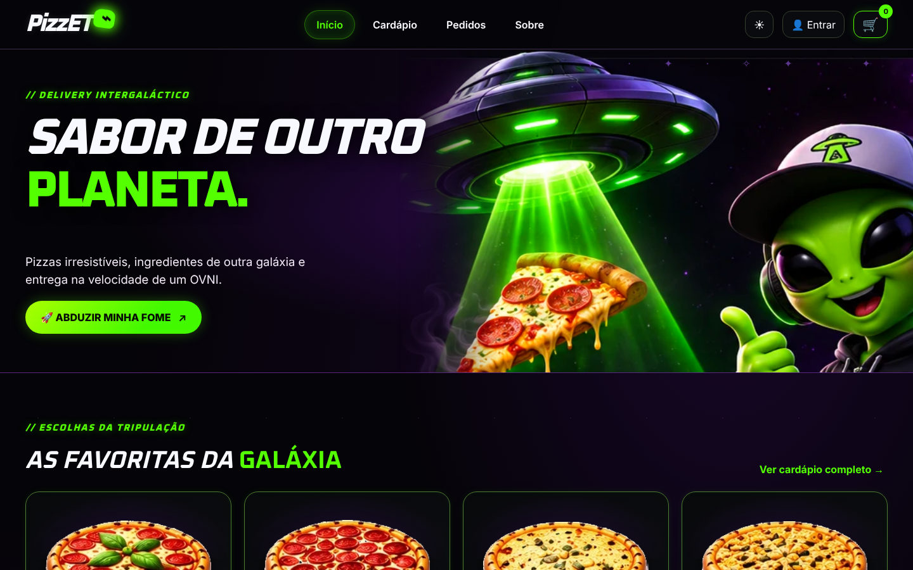

# PizzET 🛸🍕

> *A pizza mais rápida da galáxia.*

Sistema web acadêmico de delivery de pizzas com tema espacial, desenvolvido como trabalho interdisciplinar de **Front-End**, **Lógica e Programação (C#)** e **Banco de Dados (MySQL)**. Entrega: **15/11/2026**.

## Estado atual (04/11/2026)

O Front-End V2 (HTML, CSS e JS puros) está **integrado à API C# e ao MySQL**. O cliente consegue:

- se cadastrar e entrar;
- ver o cardápio e buscar;
- montar o carrinho;
- finalizar o pedido com pagamento simulado;
- acompanhar o status.

O administrador gerencia produtos e o status dos pedidos.

Tudo isso foi **testado automaticamente no ambiente de desenvolvimento** (ver `docs/plano-de-testes.md`). Ainda **não foi publicado** e ainda não foi testado nas máquinas da equipe.



## Tecnologias

| Camada | Tecnologia |
|--------|------------|
| Front-End | HTML, CSS e JavaScript puros (sem frameworks) |
| Back-End | C# — ASP.NET Core Web API |
| Banco de dados | MySQL 8 |
| Pagamento | Simulado (nenhuma cobrança real) |

Escopo: apenas **delivery** (sem retirada). Extra aprovado: acompanhamento de status do pedido.

## Estrutura

```
docs/       requisitos, arquitetura, pendências e plano de testes
frontend/   páginas HTML, CSS e JS (a criar)
backend/    API ASP.NET Core (a criar)
database/   scripts SQL, DER e consultas de demonstração (a criar)
CLAUDE.md   instruções permanentes do projeto
```

## Documentação

- [Requisitos por disciplina](docs/requisitos.md)
- [Arquitetura](docs/arquitetura.md)
- [Pendências](docs/pendencias.md)
- [Plano de testes](docs/plano-de-testes.md)
- [Deploy e evidências (FileZilla)](docs/deploy.md)

## Como executar (desenvolvimento)

1. **Banco:** no MySQL 8, execute `database/01_schema.sql` e depois `database/02_dados_demo.sql`. Crie o usuário `pizzet_app` como em [`database/README.md`](database/README.md).
2. **API:** configure a conexão e o admin de desenvolvimento com `dotnet user-secrets`, como em [`backend/README.md`](backend/README.md).
3. **Rodar:** dentro de `backend/`:

```bash
dotnet run --project PizzET.Api --launch-profile http
```

4. **Abrir:** `http://localhost:5039`. A API serve o site, então não é preciso outro servidor.
5. **Testes automatizados:** veja [`tests/README.md`](tests/README.md).

## Roteiro rápido de demonstração
1. Home → Cardápio → buscar "lactea" → adicionar pizzas ao carrinho.
2. Carrinho → "Decolar pedido". Abre o modal de login → "Criar conta" (máscaras de CPF e telefone).
3. Checkout: cadastrar endereço → confirmar. O total vem do servidor.
4. Em outra janela anônima, entrar como admin → Admin → Pedidos → avançar o status.
5. Voltar à janela do cliente → Pedidos → Acompanhar (a tela se atualiza sozinha a cada 15 s).
6. Admin → Produtos: criar, editar e desativar um produto. Ele some do cardápio.

## Equipe

A definir (2 integrantes).
