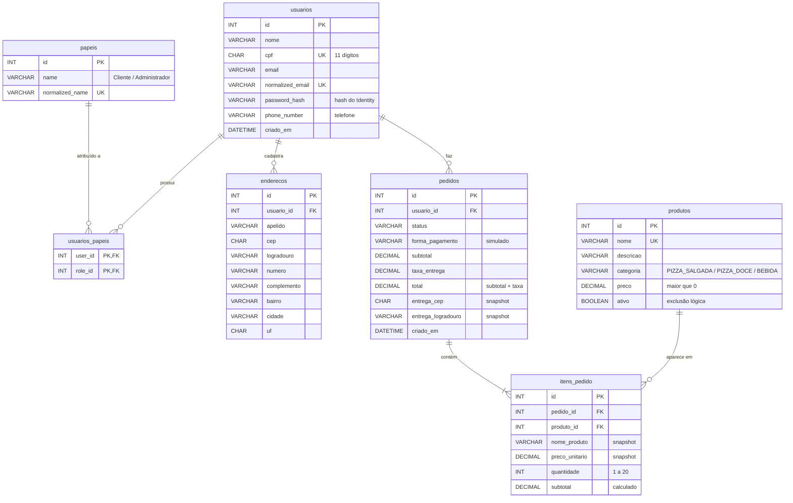

# PizzET — DER (Diagrama Entidade-Relacionamento)

Diagrama do modelo físico de `01_schema.sql`. O GitHub desenha o bloco abaixo automaticamente. Para gerar imagem, cole o bloco em https://mermaid.live. Outra opção é o **Database → Reverse Engineer** do MySQL Workbench, depois de rodar o script.

As tabelas auxiliares do Identity (`usuarios_claims`, `papeis_claims`, `usuarios_logins`, `usuarios_tokens`) foram omitidas para clareza. Todas se ligam a `usuarios` ou `papeis` por FK com `ON DELETE CASCADE`.

## Cardinalidades

| Relação | Cardinalidade | Regra ao excluir |
|---------|---------------|------------------|
| usuarios → enderecos | 1 : N | apagar usuário apaga seus endereços (CASCADE) |
| usuarios → pedidos | 1 : N | **bloqueado** se o usuário tem pedidos (RESTRICT) |
| usuarios ↔ papeis | N : N via `usuarios_papeis` | CASCADE |
| pedidos → itens_pedido | 1 : N (ao menos 1 item, garantido pela API) | apagar pedido apaga seus itens (CASCADE) |
| produtos → itens_pedido | 1 : N | **bloqueado** (RESTRICT); produtos são desativados, não apagados |

O pedido não tem FK para `enderecos`: o endereço é **copiado** para as colunas `entrega_*` no momento da compra. Assim o histórico não muda se o cliente editar ou apagar o endereço.

## Status do pedido

`RECEBIDO → EM_PREPARO → SAIU_PARA_ENTREGA → ENTREGUE`, com `CANCELADO` possível a partir de `RECEBIDO` ou `EM_PREPARO`. O banco garante apenas que o valor é um dos cinco permitidos (CHECK). A **ordem** das transições é validada na API (C#).
